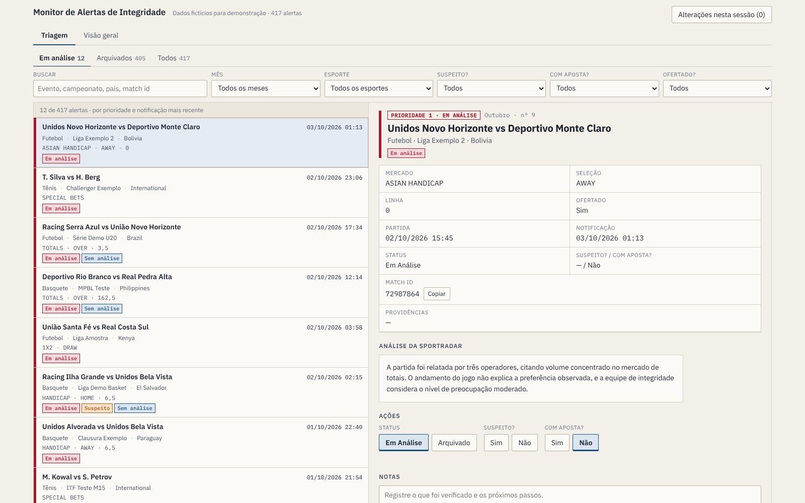
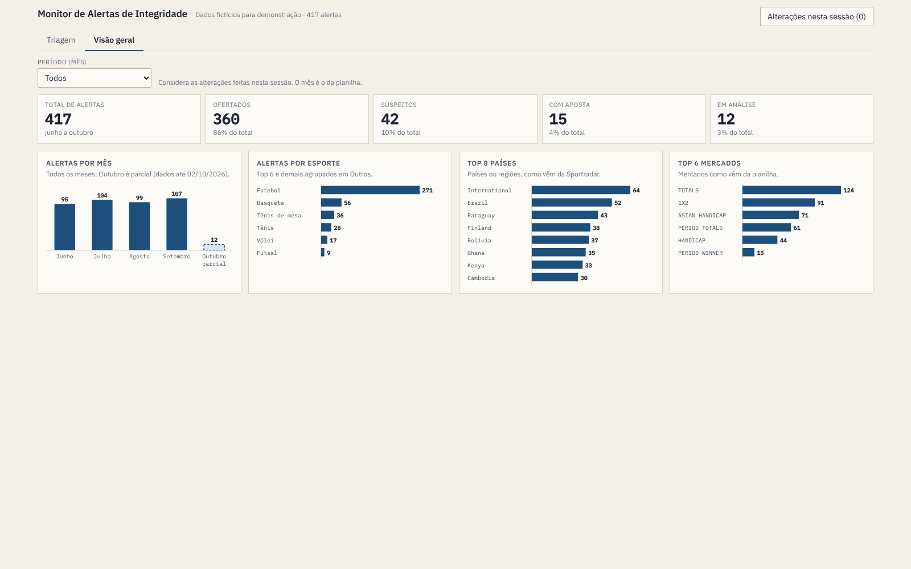

# Monitor de Alertas de Integridade

Fila de triagem e painel de acompanhamento para os alertas do **Sportradar Integrity Exchange** recebidos por uma casa de apostas esportivas.

> Este repositório usa apenas **dados fictícios**. Os eventos, IDs e análises de exemplo foram gerados para demonstração e não correspondem a alertas reais.



## O problema

Os alertas de integridade chegam por e-mail, um a um. Cada um precisava ser lido, classificado e registrado à mão numa planilha, sem uma visão clara do que analisar primeiro.

## Como funciona

```
Gmail  →  Google Apps Script  →  Google Sheets  →  Monitor
```

1. **Gmail**: os alertas ("Flagged Match") e os feedbacks da Sportradar chegam por e-mail.
2. **Google Apps Script**: um script lê esses e-mails, separa alertas de feedbacks e registra os IDs já processados para não duplicar linhas.
3. **Google Sheets**: os dados ficam numa aba por mês, com evento, esporte, campeonato, país, mercado, seleção, linha, análise da Sportradar, status, se é suspeito e se teve aposta.
4. **Monitor** (`index.html`): uma página única que lê esses dados e organiza o trabalho de análise.

## O monitor

**Triagem**
- Fila ordenada por prioridade: em análise → suspeito → com aposta → sem análise da Sportradar → demais.
- Filtros por status, mês, esporte, suspeito, com aposta e ofertado, além de busca por evento, campeonato, país ou match ID.
- Detalhe de cada alerta com a análise completa da Sportradar e um botão para copiar o match ID.
- Registro da decisão (status, suspeito, com aposta e notas) e um resumo das alterações da sessão, em texto pronto para atualizar a planilha.
- Atalhos de teclado: `j` / `k` navegam pela fila e `Enter` abre o alerta.

**Visão geral**
- Indicadores do período: total de alertas, ofertados, suspeitos, com aposta e em análise.
- Gráficos de alertas por mês e por esporte, além dos principais países e mercados.



Funciona no celular e respeita o tema claro ou escuro do sistema.

## Vídeo de demonstração

[`docs/demo.mp4`](docs/demo.mp4): 1min12, sem áudio, com legendas na tela.

## Como rodar

Abra `index.html` no navegador. Não é preciso instalar nada nem rodar servidor.

Para ver online, ative o GitHub Pages em **Settings → Pages → Deploy from a branch → main / (root)**.

## Estrutura

```
index.html                 monitor (HTML, CSS e JavaScript em um arquivo, sem bibliotecas)
data/alertas-demo.json     os mesmos dados fictícios embutidos no index.html
docs/                      capturas de tela e vídeo de demonstração
ferramentas/gravar_video.py  roteiro em Playwright usado para gravar o vídeo
```

## Limitações

- O monitor é uma foto dos dados. Ele não lê a planilha em tempo real.
- As alterações feitas na tela ficam só na memória do navegador. O botão "Alterações nesta sessão" gera o texto para atualizar a planilha manualmente.
- O código do Apps Script não está neste repositório porque está ligado à planilha da operação.

## Tecnologias

Google Apps Script · Google Sheets · HTML/CSS/JavaScript · Playwright (gravação do vídeo) · Claude (apoio no desenvolvimento)
